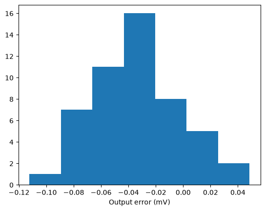

# CACE Summary for gf180mcu_ocd_ip__voltgen

**netlist source**: schematic

|      Parameter       |         Tool         |     Result      | Min Limit  |  Min Value   | Typ Target |  Typ Value   | Max Limit  |  Max Value   |  Status  |
| :------------------- | :------------------- | :-------------- | ---------: | -----------: | ---------: | -----------: | ---------: | -----------: | :------: |
| ibias1u_1 at 2x bias | ngspice              | vb1_2x               |               ​ |          ​ |            ​ |          ​ |        2.7 V |    0.758 V |   Pass ✅    |
| ibias1u_2 at 2x bias | ngspice              | vb2_2x               |           0.6 V |    0.713 V |            ​ |          ​ |            ​ |          ​ |   Pass ✅    |
| class-AB bias at 2x bias | ngspice              | vb3_2x               |           0.6 V |    0.854 V |            ​ |          ​ |            ​ |          ​ |   Pass ✅    |
| Output error         | ngspice              | err_V                |         -150 mV | -97.259 mV |            ​ |          ​ |        50 mV |   3.327 mV |   Pass ✅    |
| Line regulation      | ngspice              | linereg_VperV        |        -60 mV/V | 1.177 mV/V |            ​ |          ​ |      60 mV/V | 15.607 mV/V |   Pass ✅    |
| Output error         | ngspice              | err_V                |         -150 mV | -89.331 mV |            ​ |          ​ |        50 mV |  -0.396 mV |   Pass ✅    |
| Line regulation      | ngspice              | linereg_VperV        |        -60 mV/V | 5.411 mV/V |            ​ |          ​ |      80 mV/V | 64.753 mV/V |   Pass ✅    |
| Output error         | ngspice              | err_V                |         -200 mV | -133.893 mV |            ​ |          ​ |        50 mV |   5.712 mV |   Pass ✅    |
| Output impedance     | ngspice              | rout_ohm             |               ​ |          ​ |            ​ |          ​ |        50 kΩ |  29.495 kΩ |   Pass ✅    |
| Source limit         | ngspice              | ilim_src             |          100 nA | 112.569 nA |            ​ |          ​ |            ​ |          ​ |   Pass ✅    |
| PSRR at 1 kHz        | ngspice              | psrr_1kHz            |           25 dB |  36.216 dB |            ​ |          ​ |            ​ |          ​ |   Pass ✅    |
| PSRR at 1 kHz        | ngspice              | psrr_1kHz            |           25 dB |  28.283 dB |            ​ |          ​ |            ​ |          ​ |   Pass ✅    |
| Settling excursion   | ngspice              | under_V              |               ​ |          ​ |            ​ |          ​ |       0.5 mV |   0.036 mV |   Pass ✅    |
| Overshoot            | ngspice              | over_V               |               ​ |          ​ |            ​ |          ​ |       0.1 mV |   0.004 mV |   Pass ✅    |
| Noise density at 1 kHz | ngspice              | n_1kHz_VrtHz         |               ​ |          ​ |            ​ |          ​ |  1000 nV/√Hz | 751.880 nV/√Hz |   Pass ✅    |
| Total integrated noise | ngspice              | ntot_Vrms            |               ​ |          ​ |            ​ |          ​ |       500 µV | 307.797 µV |   Pass ✅    |
| Leakage at 1.2 V     | ngspice              | leak_1v2_A           |         -1.0 nA |  -0.023 nA |            ​ |          ​ |       1.0 nA |   0.059 nA |   Pass ✅    |
| Shunt resistance at mid-rail | ngspice              | rshunt_ohm           |          100 MΩ | 4225.560 MΩ |            ​ |          ​ |            ​ |          ​ |   Pass ✅    |
| Output error         | ngspice              | err_V                |         -150 mV | -112.379 mV |            ​ |          ​ |        50 mV |  48.447 mV |   Pass ✅    |

## Plots

## voltgen_mc_err

